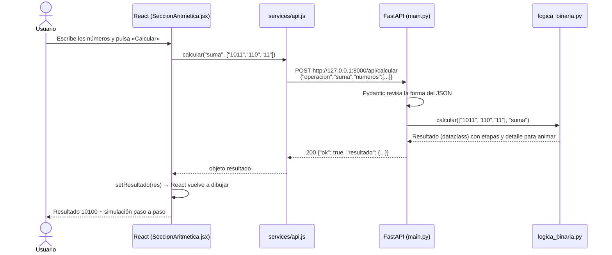

# Simulador Binario — Explicación de la versión 7 (cliente-servidor)

Este documento explica **qué cambió** respecto a la versión 6, **cómo está organizado** el proyecto, **cómo viaja la información** entre la página y Python, y **cómo se prueba**.

---

## 1. Resumen en una frase

En la v6, Python corría **dentro del navegador** (Pyodide). En la v7, Python corre en un **servidor de verdad** (FastAPI) y la página está hecha con **React + Vite**, igual que el proyecto del *Analizador Léxico*.

| | Versión 6 | Versión 7 |
|---|---|---|
| Dónde corre Python | En el navegador (Pyodide, se descargaba de internet) | En tu computadora, como servidor **FastAPI + Uvicorn** (puerto 8000) |
| Interfaz | HTML + CSS + `app.js` (1 856 líneas manipulando el DOM a mano) | **React 18 + Vite 5 + CSS puro**, dividida en componentes (puerto 5173) |
| Comunicación | `app.js` → `puente.py` (función `atender`) | `services/api.js` → **peticiones HTTP** (`fetch`) → `main.py` |
| Lógica binaria | `logica_binaria.py`, `conversion_numeros.py`, `conversion_texto.py`, `pruebas.py` | **Los mismos archivos, sin cambios** (ahora en `backend/`) |
| Instalación | Ninguna (abrir con un servidor estático) | `npm run instalar` (un solo comando) |
| Pruebas | `pruebas.py` (25 casos de la rúbrica) | `pruebas.py` + **33 pruebas automáticas de la API** (`npm test`) |
| Publicar | GitHub Pages | Necesita un lugar que ejecute Python (ver sección 10) |

Todo lo que la v6 hacía se conserva: Decimal ↔ Binario con procedimiento, Texto ↔ ASCII con desglose por pesos y tabla de referencia, Aritmética de 2 a 6 números por etapas con simulación animada (suma/resta por columnas, multiplicación por desplazamiento, división en casita), historial, confeti, y la sección de Pruebas que abre cada caso en su sección. El diseño visual (colores, animaciones, versión para celular) es el mismo.

---

## 2. Tecnologías (las mismas del Analizador Léxico)

| Parte | Tecnología | Para qué |
|---|---|---|
| Frontend | **React 18** | Construir la interfaz con componentes y estado |
| | **Vite 5** | Servidor de desarrollo (recarga instantánea) y compilación |
| | **CSS puro** | Estilos (sin Tailwind ni librerías) |
| Backend | **FastAPI** | Definir las rutas `/api/...` que reciben y responden JSON |
| | **Uvicorn** | El servidor que ejecuta FastAPI |
| | **Pydantic** | Revisar que el JSON que llega tenga la forma correcta |
| Herramientas | Node.js 18+ y Python 3.10+ | Para ejecutar todo |

Las versiones están fijas en `backend/requirements.txt` (copiado de tu analizador) y en `frontend/package-lock.json` (las mismas versiones de React y Vite que ya te funcionan).

---

## 3. Estructura de carpetas

```
simulador-binario/
├── package.json              ← comandos de un solo paso: instalar, dev, test, build
├── instalar.bat              ← doble clic = npm run instalar
├── iniciar.bat               ← doble clic = npm run dev
├── stop.bat                  ← detiene los puertos 8000 y 5173 (igual que en el analizador)
├── README.md                 ← portada del repositorio en GitHub
├── EXPLICACION.md            ← este documento
├── docs/capturas/            ← imágenes para el README
├── scripts/                  ← los programas que ejecutan los comandos de npm
│   ├── instalar.mjs          ← crea el venv, instala pip y npm, comprueba todo
│   ├── dev.mjs               ← arranca backend + frontend juntos (Ctrl+C detiene ambos)
│   ├── probar.mjs            ← corre las pruebas
│   └── comun.mjs             ← rutas y funciones compartidas
├── .vscode/                  ← tareas de VS Code: instalar, dev, pruebas, stop
│
├── backend/                  ← PYTHON (FastAPI)
│   ├── main.py               ← NUEVO: servidor, rutas /api/*, CORS y manejo de errores
│   ├── logica_binaria.py     ← suma, resta, multiplicación, división (sin cambios)
│   ├── conversion_numeros.py ← decimal ↔ binario (sin cambios)
│   ├── conversion_texto.py   ← texto ↔ ASCII ↔ binario (sin cambios)
│   ├── pruebas.py            ← 25 casos de la rúbrica (solo se agregó el código de salida)
│   ├── requirements.txt      ← fastapi, uvicorn, pydantic
│   ├── tests/test_api.py     ← NUEVO: 33 pruebas automáticas de la API
│   └── venv/                 ← (lo crea instalar; NO se sube a GitHub)
│
└── frontend/                 ← REACT + VITE
    ├── index.html            ← la única página; React dibuja dentro de <div id="root">
    ├── vite.config.js        ← puerto 5173, abre el navegador al arrancar
    ├── package.json          ← react, react-dom, vite, @vitejs/plugin-react
    ├── .env.example          ← dirección del backend (opcional)
    ├── public/favicon.svg
    └── src/
        ├── main.jsx          ← arranque: monta <App /> en la página
        ├── App.jsx           ← estado general, conexión con el servidor, las 4 secciones
        ├── index.css         ← importa los estilos en orden
        ├── estilos/          ← el CSS de la v6 dividido en 9 archivos + 1 nuevo
        ├── services/api.js   ← ÚNICO archivo que habla con el backend
        ├── data/constantes.js← textos, ejemplos, nombres de cada número (rolesPara)
        ├── hooks/useHistorial.js ← historial guardado en localStorage
        ├── components/       ← piezas reutilizables: Encabezado, Bit, Selector, Vacio, BotonCopiar, Fondo
        ├── secciones/        ← SeccionNumeros, SeccionTexto, SeccionAritmetica, SeccionPruebas
        └── simulacion/       ← la animación bit por bit
            ├── TarjetaSimulacion.jsx ← controles ⏮ ◀ ▶ ▶▶, barra, velocidad, etapas, confeti
            ├── lineaTiempo.jsx       ← une las etapas (A+B, luego +C…) en una sola línea de tiempo
            ├── Columnas.jsx          ← suma y resta columna por columna
            ├── Multiplicacion.jsx    ← desplazar y sumar
            ├── Division.jsx          ← división larga en formato casita
            └── Pizarra.jsx           ← filas, reglas y tamaño de los bits
```

**¿Qué pasó con `puente.py` y `app.js`?** Ya no existen: `puente.py` fue reemplazado por `main.py` (mismas rutas, ahora reales) y `app.js` se repartió en los componentes de React.

---

## 4. Cómo viaja la información

### 4.1 El viaje completo (ejemplo: 1011 + 110 + 11)



### 4.2 Paso a paso

1. **El usuario escribe** en un `<input>`. React guarda el texto en el **estado** (`useState`) del componente.
2. **Al pulsar Calcular**, `SeccionAritmetica.jsx` llama a `calcular(operacion, numeros)` de `services/api.js`.
3. **`api.js` hace la petición HTTP** con `fetch`:
   ```http
   POST /api/calcular HTTP/1.1
   Host: 127.0.0.1:8000
   Content-Type: application/json

   {"operacion": "suma", "numeros": ["1011", "110", "11"]}
   ```
4. **FastAPI recibe la petición.** Antes de entrar a la función, **Pydantic** compara el JSON con el modelo `PeticionCalculo` (`operacion: str`, `numeros: list[str]`). Si falta un campo o el tipo es incorrecto, responde un error 422 sin llegar a la lógica.
5. **La ruta llama a la lógica** (`logica_binaria.calcular`), que valida cada número, resuelve las etapas de izquierda a derecha y verifica el resultado en decimal.
6. **FastAPI convierte la respuesta a JSON** (`asdict` transforma la dataclass en diccionario):
   ```json
   {
     "ok": true,
     "resultado": {
       "operacion": "suma", "simbolo": "+",
       "numeros": ["1011", "110", "11"], "numeros_dec": ["11", "6", "3"],
       "resultado": "10100", "res_dec": "20", "verificado": true,
       "etapas": [
         { "numero": 1, "a": "1011", "b": "110", "resultado": "10001", "detalle": { "tipo": "suma", "columnas": [ ... ] } },
         { "numero": 2, "a": "10001", "b": "11", "resultado": "10100", "detalle": { ... } }
       ]
     }
   }
   ```
7. **React recibe el objeto**, lo guarda con `setResultado(...)` y **vuelve a dibujar** la pantalla: aparece la franja del resultado, los botones de etapas y la simulación.

### 4.3 ¿Y si algo sale mal?

Todas las respuestas de error tienen **la misma forma** (igual que en la v6), así el frontend solo lee `error.mensaje`:

```json
{ "ok": false, "error": { "tipo": "DivisionPorCero", "mensaje": "Número C: no se puede dividir entre 0." } }
```

| Situación | Código HTTP | `tipo` |
|---|---|---|
| Dato inválido (ej. `102` en binario, `-5` en decimal) | 422 | `EntradaInvalida` |
| División entre 0 | 422 | `DivisionPorCero` |
| Operación o modo que no existe | 422 | `OperacionDesconocida`, `ModoDesconocido`, `ModoNumeroDesconocido` |
| JSON mal formado, falta un campo o tipo incorrecto | 422 | `PeticionInvalida` |
| Ruta que no existe | 404 | `NoEncontrado` |
| Error inesperado (un bug) | 500 | `ErrorInterno` |
| **El servidor está apagado** | — (no hay respuesta) | El frontend muestra *«No se pudo conectar con el servidor…»* |

Cuando el servidor está apagado, el indicador de arriba a la derecha se pone **rojo** («Servidor apagado»), aparece un aviso con instrucciones y la página **reintenta sola cada 4 segundos**. En cuanto enciendes el backend, vuelve a **verde** sin recargar.

### 4.4 ¿Qué es CORS y por qué hace falta?

La página vive en `http://localhost:5173` y el servidor en `http://127.0.0.1:8000`: para el navegador son **orígenes distintos**. Por seguridad, el navegador no deja que una página lea respuestas de otro origen **a menos que el servidor lo autorice**. Eso hace `CORSMiddleware` en `main.py`: agrega a cada respuesta la cabecera `Access-Control-Allow-Origin` solo para los orígenes de la lista `ORIGENES_PERMITIDOS` (puertos 5173 y 4173). Si algún día cambias el puerto del frontend, agrégalo a esa lista.

---

## 5. El backend (`backend/main.py`)

`main.py` es el sucesor de `puente.py`. Sus partes, en orden:

1. **`app = FastAPI(...)`** — crea la aplicación. Uvicorn la busca con `uvicorn main:app`.
2. **Middleware de errores inesperados** — si una ruta truena por un bug, responde 500 en JSON en lugar de cortar la conexión.
3. **`CORSMiddleware`** — permisos para el frontend (sección 4.4). Se registra *después* del middleware de errores para que también las respuestas 500 lleven los permisos.
4. **Manejadores de excepciones** (`@app.exception_handler`):
   - `ErrorBinario` → los errores esperados de la lógica (todas las clases de error de tus `.py` heredan de ella).
   - `RequestValidationError` → cuando Pydantic rechaza el JSON.
   - `HTTPException` → 404 y 405 con la misma forma de error.
5. **Modelos de Pydantic** — el "molde" de cada petición: `PeticionCalculo`, `PeticionTexto`, `PeticionNumero`.
6. **Rutas** — cada una llama a la lógica y devuelve un diccionario.

### Rutas de la API

| Método | Ruta | Recibe | Devuelve | Lógica que usa |
|---|---|---|---|---|
| GET | `/` | — | mensaje de bienvenida | — |
| GET | `/health` | — | `{"status": "ok"}` | — |
| GET | `/api/operaciones` | — | operaciones y límites (64 bits, 6 números, 100 caracteres) | `logica_binaria`, `conversion_texto` |
| POST | `/api/convertir-numero` | `{"modo": "decimal_a_binario", "valor": "25"}` | `conversion` con pasos | `conversion_numeros.convertir_numero` |
| POST | `/api/convertir` | `{"modo": "texto_a_binario", "texto": "HOLA"}` | `conversion` con cada carácter y su desglose | `conversion_texto.convertir` |
| GET | `/api/tabla-ascii` | — | 5 grupos de la tabla de referencia | `conversion_texto.tabla_ascii` |
| POST | `/api/calcular` | `{"operacion": "suma", "numeros": ["1011", "110"]}` | `resultado` con etapas y detalle | `logica_binaria.calcular` |
| GET | `/api/pruebas` | — | 25 filas con esperado/obtenido | `pruebas.ejecutar_pruebas` |

**Documentación interactiva:** con el backend encendido abre <http://127.0.0.1:8000/docs>. FastAPI genera esa página sola: ahí puedes probar cada ruta con el botón *Try it out*, sin la interfaz. Es muy útil para la demostración de «cómo viaja la información».

> Cambio menor respecto a `puente.py`: ya no se acepta el formato viejo `{"a": ..., "b": ...}` en `/api/calcular`; solo `{"numeros": [...]}`, que es el que usa la interfaz desde la v6.

---

## 6. El frontend (React)

### 6.1 De dónde sale lo que ves

```
index.html  →  main.jsx  →  <App />
                              ├── <Fondo />            manchas de color
                              ├── <Encabezado />       logo, menú de secciones, indicador del servidor
                              ├── <SeccionNumeros />   Decimal ↔ Binario
                              ├── <SeccionTexto />     Texto ↔ ASCII (+ <TablaAscii />, <Desglose />)
                              ├── <SeccionAritmetica /> calculadora + historial + <TarjetaSimulacion />
                              └── <SeccionPruebas />   tabla de la rúbrica
```

- **`App.jsx`** guarda lo que comparten todas las secciones: cuál se ve (`vista`), el estado del servidor, y las operaciones/límites que manda el backend. También coordina que al tocar una fila de **Pruebas** se abra en su sección (estado `carga`).
- **Las 4 secciones se dibujan siempre y solo se ocultan** con el atributo `hidden`. Por eso, si escribes algo en Texto y te vas a Aritmética, al regresar sigue ahí (igual que en la v6).
- **`services/api.js`** es el único que usa `fetch`. Ningún componente habla con el servidor directamente. Distingue dos errores: `ErrorApi` (el servidor respondió con un error, ej. dato inválido) y `ErrorConexion` (el servidor no respondió).
- **Colores por sección/operación:** igual que en la v6, el CSS lee `<body data-vista="..." data-op="...">`. React actualiza esos atributos con `useEffect`.

### 6.2 Conceptos de React que se usan

| Concepto | Dónde | Qué hace |
|---|---|---|
| `useState` | todas las secciones | Guarda datos que, al cambiar, redibujan la pantalla (texto escrito, resultado, paso actual…) |
| `useEffect` | carga inicial, reintentos, animación | Ejecuta código *después* de dibujar: pedir datos, programar temporizadores, escuchar teclas |
| `useRef` | temporizadores, inputs | Guarda algo que no debe redibujar (ej. el temporizador de 300 ms al escribir) |
| `useMemo` | simulación | Calcula una sola vez la línea de tiempo de cada resultado |
| props | todos los componentes | Datos y funciones que el padre le pasa al hijo (`activa`, `onConexion`, `carga`…) |
| `key` | listas y animaciones | Le dice a React qué elemento es cuál; cambiarla obliga a crear uno nuevo (y repetir su animación) |

### 6.3 La simulación paso a paso (lo más distinto a la v6)

En la v6, `app.js` creaba los elementos una vez y luego les cambiaba clases a mano en cada paso (`pintar(k)`). En React se piensa al revés: **toda la pizarra depende de un solo número `k` (el paso actual)**.

- `lineaTiempo.jsx` toma las etapas que manda el backend y calcula cuántos pasos tiene cada una. Con 3 o más números, la barra recorre las etapas seguidas (etapa 1: A+B, etapa 2: resultado+C…).
- Cada pizarra (`Columnas.jsx`, `Multiplicacion.jsx`, `Division.jsx`) es una función que recibe `k` y **dibuja cómo se ve la operación en ese paso**: qué bits ya se escribieron, cuál está resaltado (`activa`), cuál acaba de aparecer (`nuevo`, con animación).
- `TarjetaSimulacion.jsx` solo cambia `k`: ▶ lo aumenta cada 950 ms (o la velocidad elegida), ◀/▶ lo mueven de uno en uno, la barra lo pone donde la sueltes. React se encarga de redibujar.
- Las **leyendas** (la explicación en palabras de cada paso) son las mismas frases de la v6.

### 6.4 Estilos

El CSS es el de la v6 **sin cambios de diseño**, dividido en `src/estilos/01-tema.css` … `09-aritmetica.css` y cargado **en el mismo orden** desde `index.css` (el orden importa: las reglas de abajo pueden sobrescribir a las de arriba). Lo único nuevo es `10-servidor.css`: el indicador «Conectando / conectado / apagado» y el aviso cuando el backend no responde.

---

## 7. Pruebas

| Nivel | Archivo | Qué comprueba | Cómo correrlo |
|---|---|---|---|
| Lógica (rúbrica) | `backend/pruebas.py` | 25 casos: 25 → 00011001, HOLA → 72, 79, 76, 65, validaciones, aritmética de 3 y 4 números, división entre 0 | `npm test` o la sección **Pruebas** de la página |
| API (peticiones) | `backend/tests/test_api.py` | 33 pruebas que **levantan el servidor real** y le mandan peticiones HTTP como el navegador | `npm test` |

Las 33 pruebas de la API están agrupadas así:

1. **Rutas básicas:** `/`, `/health`, `/api/operaciones`, 404 con formato de error, 405 por método equivocado, y que un error inesperado responda 500 en JSON (con permisos CORS).
2. **Decimal ↔ Binario:** casos de la rúbrica, 0, el máximo de 64 bits, valores inválidos (`-5`, `12a`, `3.5`, vacío, 2⁶⁴) y modo desconocido.
3. **Texto ↔ ASCII:** HOLA en ambos sentidos, grupo incompleto que se rellena, ñ (ASCII extendido), emoji y otros inválidos, tabla ASCII.
4. **Aritmética:** suma de 3 por etapas, resta con resultado negativo, multiplicación, división con residuo, división entre 0 (dice qué número), número inválido (dice cuál), de 2 a 6 números, operación desconocida.
5. **Peticiones mal formadas:** falta un campo, tipo incorrecto, JSON roto.
6. **CORS:** origen permitido, *preflight* de POST, origen ajeno rechazado, errores que también llevan permisos.
7. **Rúbrica por la API:** los 25 casos de `/api/pruebas` pasan.

Las pruebas solo usan la biblioteca estándar de Python (`unittest` y `urllib`): no hay que instalar nada extra.

**Además**, durante el desarrollo se probó la interfaz completa en un navegador automatizado (Chromium): 46 verificaciones en las 4 secciones (conversiones, errores, simulación, pausa, etapas, historial, Esc, abrir pruebas en su sección, vista de celular, consola sin errores de React), más una prueba de apagar y volver a encender el servidor. Esa prueba no se incluye en el proyecto porque requiere instalar Playwright y un navegador aparte.

---

## 8. Comandos

Todos se ejecutan desde la **carpeta raíz** del proyecto (donde está este archivo):

| Comando | Qué hace |
|---|---|
| `npm run instalar` | Revisa Node y Python, crea `backend/venv`, instala FastAPI/Uvicorn/Pydantic y React/Vite, y comprueba que todo quedó listo. Se puede repetir sin problema. |
| `npm run dev` | Arranca **los dos** servidores en la misma ventana (`[API]` en azul, `[WEB]` en verde) y abre el navegador. **Ctrl + C** detiene ambos. |
| `npm test` | Corre las 33 pruebas de la API y los 25 casos de la rúbrica. |
| `npm run build` | Compila el frontend para producción en `frontend/dist/`. |

En Windows también puedes usar **doble clic** en `instalar.bat`, `iniciar.bat` y `stop.bat`. En VS Code: **Terminal → Run Task…** → `instalar`, `dev`, `pruebas` o `stop` (las mismas tareas que en el analizador, más `instalar` y `pruebas`).

---

## 9. Problemas comunes

| Problema | Solución |
|---|---|
| El indicador dice **«Servidor apagado»** | El backend no está corriendo. Usa `npm run dev` (arranca los dos). La página se reconecta sola. |
| `El puerto 8000 (o 5173) ya está ocupado` | Ya hay una copia corriendo. Ciérrala con `stop.bat` (o la tarea *stop*) y vuelve a intentar. |
| `No se encontró Python 3.10 o más nuevo` | Instala Python desde python.org y marca **«Add python.exe to PATH»**. |
| En PowerShell: *«la ejecución de scripts está deshabilitada»* al escribir `npm` | Usa `npm.cmd run instalar`, o los `.bat`, o ejecuta una vez `Set-ExecutionPolicy -Scope CurrentUser RemoteSigned`. |
| Copiaste el proyecto de otra computadora y el venv no sirve | `npm run instalar` detecta el venv roto y lo vuelve a crear. |
| Cambiaste el puerto del frontend y todo da error de conexión | Agrega el nuevo origen a `ORIGENES_PERMITIDOS` en `backend/main.py` (CORS). |
| El backend está en otra dirección | Copia `frontend/.env.example` como `frontend/.env` y cambia `VITE_API_URL`. |

---

## 10. Subir a GitHub

El proyecto ya viene preparado:

- **`.gitignore`** excluye `backend/venv/`, `node_modules/`, `frontend/dist/`, `__pycache__/` y archivos `.env`. *No subas el venv*: pesa mucho, solo funciona en tu computadora y cualquiera lo recrea con `npm run instalar`.
- **`.gitattributes`** mantiene los `.bat` con saltos de línea de Windows.
- **`README.md`** es la portada que GitHub muestra, con capturas e instrucciones.

Pasos (desde la carpeta raíz, después de crear el repositorio vacío en GitHub):

```bash
git init
git add .
git commit -m "Simulador Binario v7: React + Vite + FastAPI"
git branch -M main
git remote add origin https://github.com/TU-USUARIO/simulador-binario.git
git push -u origin main
```

Quien lo clone solo necesita Node.js y Python, y ejecutar `npm run instalar` y luego `npm run dev`.

**Sobre GitHub Pages:** la v6 se podía publicar ahí porque era una página estática. La v7 **necesita un servidor que ejecute Python**, y GitHub Pages solo sirve archivos estáticos. Para tenerla en línea habría que publicar el backend en un servicio que ejecute Python, el frontend compilado (`npm run build`) en un hosting estático, apuntar `VITE_API_URL` a la dirección del backend y agregar la dirección del frontend a `ORIGENES_PERMITIDOS`. Para la clase y la demostración basta con correrlo en tu computadora.

---

## 11. Límites (los mismos de la v6)

- Números: hasta **64 bits** (`MAX_BITS` en `logica_binaria.py`).
- Aritmética: de **2 a 6 números** (`MAX_NUMEROS` en `logica_binaria.py`; la interfaz lo lee del backend).
- Texto: hasta **100 caracteres** (`MAX_CARACTERES` en `conversion_texto.py`; la interfaz lo lee del backend).
