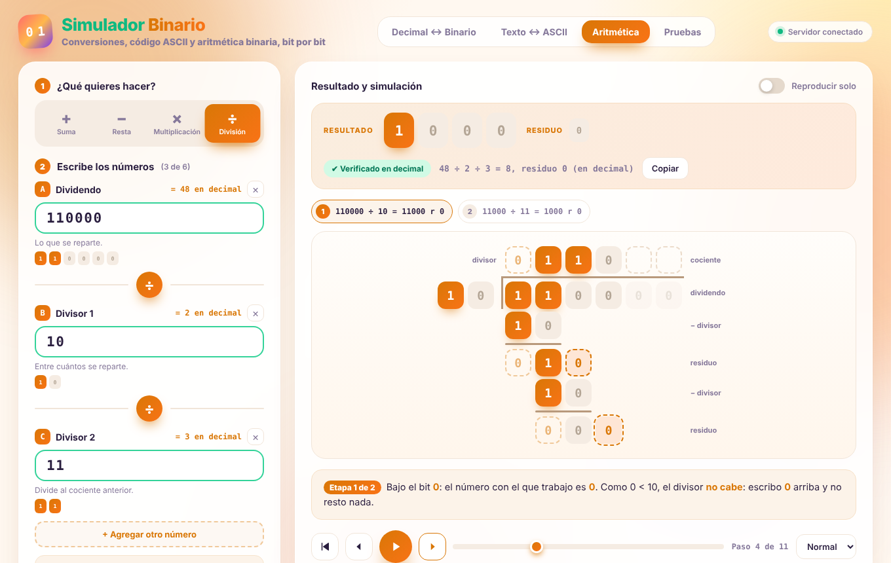
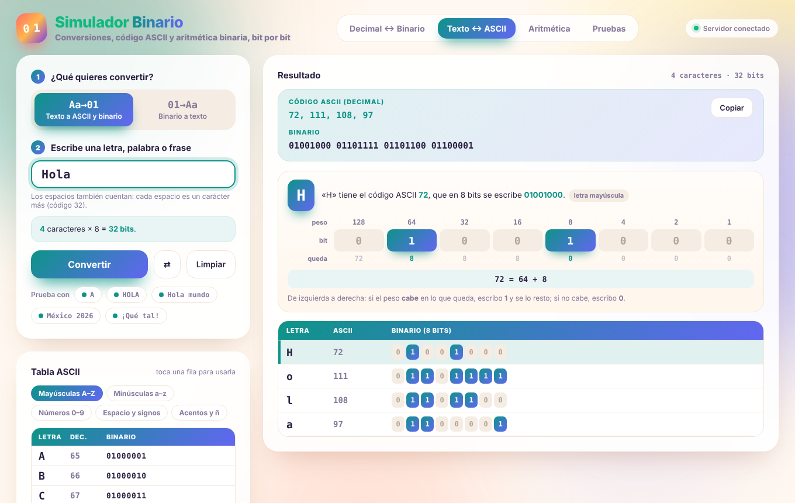
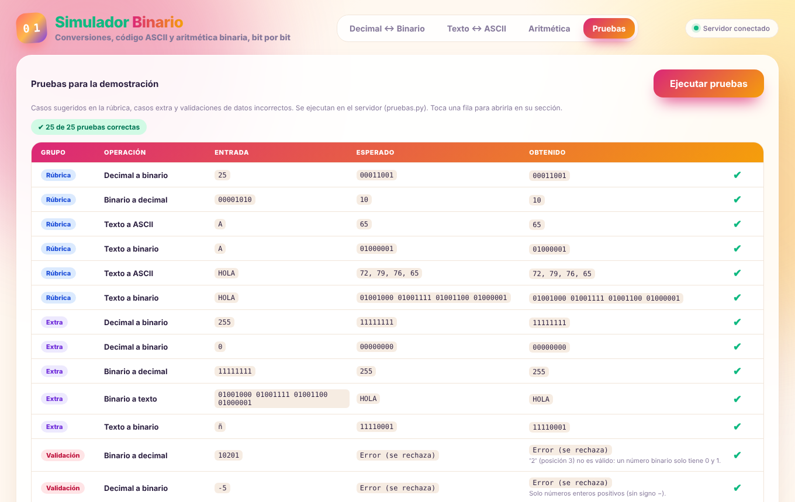

# Simulador Binario

Conversiones **decimal ↔ binario**, **texto ↔ código ASCII ↔ binario** y **aritmética binaria** (suma, resta, multiplicación y división de 2 a 6 números), resueltas **bit por bit** y con el procedimiento animado paso a paso.

Proyecto de **Arquitectura de Computadoras** · Versión 7 (cliente-servidor).



| Decimal ↔ Binario | Texto ↔ ASCII | Pruebas |
|---|---|---|
|  |  |  |

## Tecnologías

- **Frontend:** React 18 + Vite 5 + CSS puro
- **Backend:** Python + FastAPI + Uvicorn + Pydantic
- Toda la lógica binaria está en Python (`backend/`); la interfaz solo dibuja lo que responde el servidor.

## Requisitos

- [Node.js](https://nodejs.org) 18 o más nuevo
- [Python](https://www.python.org/downloads/) 3.10 o más nuevo (en Windows, marca «Add python.exe to PATH» al instalar)

## Instalación (un solo comando)

```bash
git clone https://github.com/TU-USUARIO/simulador-binario.git
cd simulador-binario
npm run instalar
```

Crea el entorno virtual de Python, instala FastAPI y React/Vite, y comprueba que todo quedó listo. En Windows también puedes dar doble clic en **`instalar.bat`**.

## Uso

```bash
npm run dev
```

Arranca el backend (<http://127.0.0.1:8000>) y el frontend (<http://localhost:5173>) en la misma ventana y abre el navegador. **Ctrl + C** detiene los dos. En Windows: doble clic en **`iniciar.bat`** (y **`stop.bat`** para detener).

Con el backend encendido, la documentación interactiva de la API está en <http://127.0.0.1:8000/docs>.

## Pruebas

```bash
npm test
```

Corre **33 pruebas automáticas de la API** (levantan el servidor real y le mandan peticiones HTTP) y los **25 casos de la rúbrica** (`backend/pruebas.py`), que también se pueden ver en la sección **Pruebas** de la página.

## Estructura

```
backend/    FastAPI: main.py (rutas /api/*) + lógica binaria en Python + tests/
frontend/   React + Vite: src/secciones, src/components, src/simulacion, src/services/api.js
scripts/    instalar.mjs, dev.mjs, probar.mjs (lo que ejecutan los comandos npm)
```

## API

| Método | Ruta | Descripción |
|---|---|---|
| GET | `/api/operaciones` | Operaciones disponibles y límites |
| POST | `/api/convertir-numero` | Decimal ↔ binario con procedimiento |
| POST | `/api/convertir` | Texto ↔ ASCII ↔ binario con desglose por pesos |
| GET | `/api/tabla-ascii` | Tabla ASCII de referencia |
| POST | `/api/calcular` | Aritmética binaria de 2 a 6 números, por etapas |
| GET | `/api/pruebas` | Ejecuta los casos de la rúbrica |

📖 La explicación completa (cómo viaja la información, cada archivo, pruebas, problemas comunes) está en **[EXPLICACION.md](EXPLICACION.md)**.

## Límites

Números de hasta 64 bits · de 2 a 6 números por operación · texto de hasta 100 caracteres.
